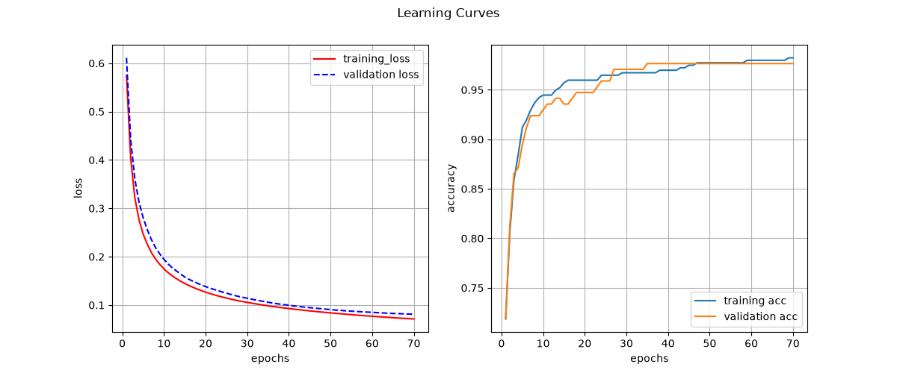

# Multilayer Perceptron

Многослойный перцептрон, написанный с нуля на NumPy, без PyTorch, TensorFlow и scikit-learn. Прямой и обратный проход, функции потерь, оптимизаторы и инициализация весов реализованы вручную.

В качестве примера библиотека применяется к задаче классификации опухолей молочной железы (доброкачественная или злокачественная).

## Возможности

| Компонент | Реализовано |
|---|---|
| Слои | полносвязный слой `DenseNetworkLayer` |
| Активации | `identity`, `relu`, `leaky_relu`, `sigmoid`, `tanh`, `softmax` |
| Функции потерь | `mse`, `mae`, `bce`, `bce_with_logits`, `cce`, `cce_with_logits` |
| Оптимизаторы | `sgd`, `momentum`, `adam` |
| Инициализация | `xavier_normal`, `xavier_uniform`, `kaiming_normal`, `kaiming_uniform` |
| Обучение | мини-батчи, перемешивание данных, валидация после каждой эпохи, история метрик |
| Сохранение | конфигурация и веса в одном `.npz`, дополнительные массивы (например, параметры нормализации) |

## Установка

Нужен Python 3.12 или новее.

```bash
git clone https://github.com/EgorShabardin/multilayer_perceptron
cd multilayer_perceptron
python -m venv .venv
.venv\Scripts\activate
pip install -r requirements.txt
pip install -e .
```

## Быстрый старт

Сеть с одним скрытым слоем учит XOR, задачу, которую нельзя решить линейной моделью:

```python
import numpy as np

from multilayer_perceptron import DenseNetworkLayer, PerceptronNetwork

x = np.array([[0, 0], [0, 1], [1, 0], [1, 1]], dtype=float)
y = np.array([[0], [1], [1], [0]], dtype=float)

rng = np.random.default_rng(0)
layers = [
    DenseNetworkLayer(2, 8, "tanh", "xavier_normal", rng=rng),
    DenseNetworkLayer(8, 1, "identity", "xavier_normal", rng=rng),
]

network = PerceptronNetwork(layers, "bce_with_logits", "adam", seed=0, optimizer_parameters={"learning_rate": 0.05})
history = network.fit(x, y, epochs=500)

loss, accuracy = network.evaluate(x, y)
print(f"loss: {loss:.4f}, accuracy: {accuracy:.2f}")
```

Сохранение и загрузка:

```python
network.save_network("models/xor")
network, extra = PerceptronNetwork.load_network("models/xor")
```

## Пример: классификация опухолей

### Запуск

Все команды выполняются из корня проекта:

```bash
python examples/tumor_class/analysis.py     # анализ данных
python examples/tumor_class/processing.py   # разбиение на train и validation (70/30)
python examples/tumor_class/train.py        # обучение и сохранение модели в models/
python examples/tumor_class/predict.py      # загрузка модели и оценка качества
```

### Анализ данных

- Пропусков и дубликатов нет.
- Классы распределены примерно как 63% B и 37% M. Дисбаланс небольшой, поэтому accuracy подходит как основная метрика.
- Масштабы признаков различаются на несколько порядков, поэтому признаки стандартизуются. Среднее и стандартное отклонение считаются только по обучающей выборке и сохраняются вместе с моделью, чтобы новые данные нормализовались так же.
- Многие признаки сильно коррелируют между собой (например, радиус, периметр и площадь).

### Модель

| Параметр | Значение |
|---|---|
| Архитектура | 30 → 8 (Leaky ReLU) → 2 |
| Инициализация | Kaiming normal |
| Функция потерь | `cce_with_logits` |
| Оптимизатор | SGD, learning rate 0.01 |
| Батч | 32 |
| Эпохи | 50 |

### Результаты

| Выборка | Loss | Accuracy |
|---|---|---|
| Validation | 0.0810 | 0.9766 |



## Структура проекта

```
multilayer_perceptron/
├── multilayer_perceptron/          # библиотека
│   ├── activation_function.py      # функции активации
│   ├── loss_function.py            # функции потерь
│   ├── network.py                  # сеть: обучение, оценка, сохранение
│   ├── network_layer.py            # полносвязный слой
│   ├── optimizers.py               # SGD, Momentum, Adam
│   ├── parameter_initializer.py    # инициализация весов
│   └── registry.py                 # реестр компонентов по имени
├── examples/
│   └── tumor_class/                # пример на датасете опухолей
│       ├── analysis.py
│       ├── processing.py
│       ├── train.py
│       └── predict.py
├── data/tumor_class/               # данные
├── models/                         # сохранённые модели
├── pyproject.toml
└── requirements.txt
```
